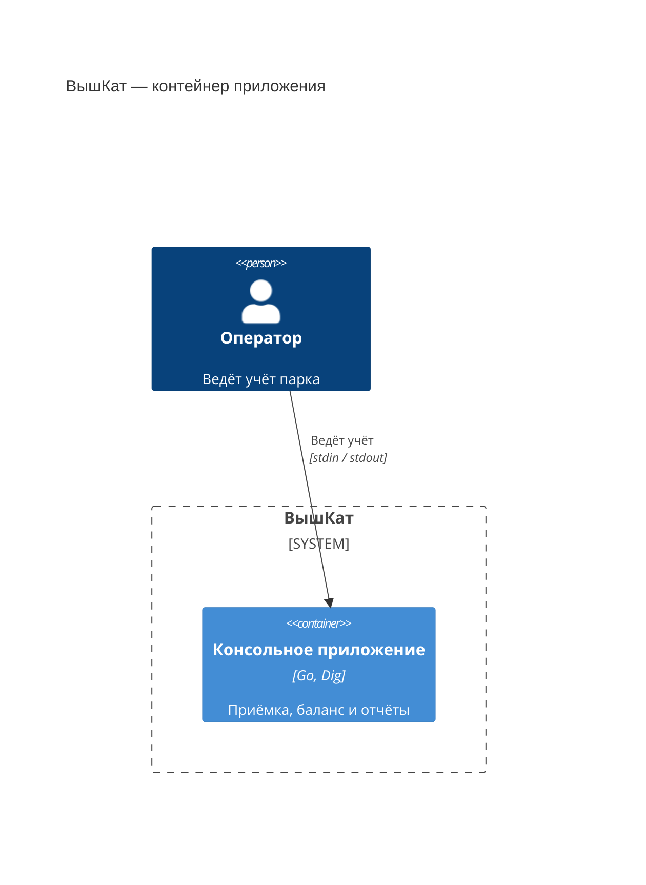
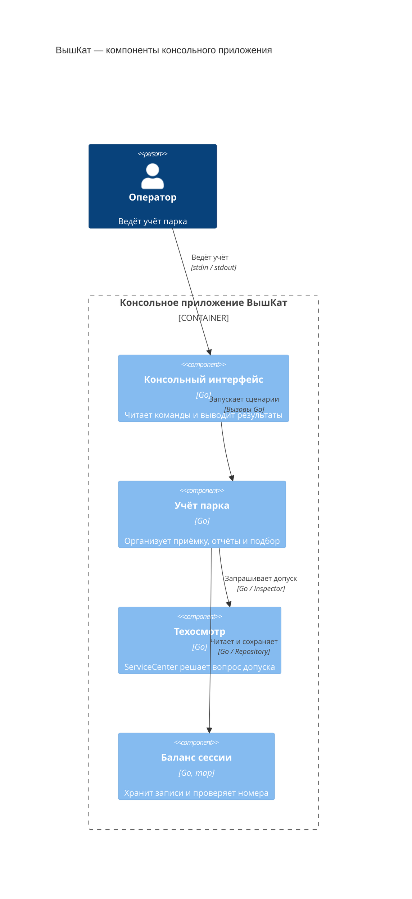

# ДЗ №1 по курсу КПО: Кикшеринг


Выполнил: студент БПИ252 Гришин Алексей Андреевич

<center>
<kbd>
  
</kbd>
</center>

Консольное приложение «ВышКат»: приёмка транспорта, учёт вещей,
отчёты по количеству и энергии, подбор техники для новичков.
Реализованы велосипед, электросамокат, электровелосипед, шлем и зарядная станция.

## Запуск и проверка

Нужна **Go 1.26 или новее**. Команды выполняются из корня проекта;
при первом запуске Go загружает зависимости из `go.mod` и `go.sum`.

```bash
go run -buildvcs=false ./cmd/escooter-sharing
```

Выберите действие по номеру и отвечайте на вопросы, завершая строки Enter.
`0` в главном меню завершает работу. Данные хранятся в памяти одной сессии;
после выхода баланс очищается.

При наличии `make` доступны команды из [Makefile](Makefile):

| Команда | Действие |
| --- | --- |
| `make run` / `make build` | Интерактивный запуск / проверка сборки всех пакетов |
| `make check` | Проверка форматирования, vet, тесты с `-race`, линтер и сборка |
| `make cover` | Тесты с `-race`, профиль `coverage.out` и общее покрытие в строке `total` |
| `make demo` | Запуск с готовым вводом из `docs/demo/session.txt` |
| `make test` / `make vet` / `make lint` | Отдельный запуск тестов / vet / линтера |
| `make fmt-check` / `make fmt` | Проверка / исправление форматирования в `cmd/` и `internal/` |

Для `make lint` и `make check` нужен **golangci-lint v2**, поддерживающий Go
проекта; конфигурация [.golangci.yml](.golangci.yml) проверена с версией 2.14.0,
собранной Go 1.27.1. Инструменты автоматически не устанавливаются.
`make check` не исправляет файлы и останавливается при ошибке.
Ориентир покрытия тестами — 60% и выше.

Флаг `-buildvcs=false` отключает сбор сведений о системе контроля версий.

## Правила учёта

- Транспорт и вещи находятся на общем балансе с уникальными инвентарными
  номерами. [Сотрудник](internal/domain/employee.go) не является инвентарём.
  Ведомость возвращает названия и номера в порядке инвентарных номеров.
- При [приёмке](internal/application/fleet.go) решение принимает
  [ServiceCenter](internal/domain/service_center.go) по введённому признаку
  исправности. Отказ оставляет транспорт на балансе, но исключает из проката;
  ошибка проверки прерывает приёмку без записи.
- [Вещи добавляются](internal/application/inventory.go) без техосмотра.
  Добавление транспорта через этот сценарий запрещено.
- Простота управления — целое число 1–10. Новичкам доступны только допущенные
  устройства со значением ≥ 6; фильтрация находится в `Fleet.BeginnerTransports`.
- Энергия — конечное неотрицательное число кВт·ч/сутки.
  [Отчёт](internal/application/reports.go) отдельно суммирует заданные расходы
  всего баланса, включая отклонённую технику и станции, и активного транспорта.
  Суммируются заданные характеристики расхода. Обычный велосипед и шлем
  не учитываются в расходе электроэнергии.

## Архитектура и SOLID

| Пакет | Ответственность |
| --- | --- |
| [domain](internal/domain) | Типы, валидация, характеристики и правило техосмотра |
| [application](internal/application) | Приёмка, учёт, отчёты и интерфейсы зависимостей |
| [infrastructure/memory](internal/infrastructure/memory) | Хранение баланса и уникальность номеров |
| [cli](internal/cli) | Меню, ввод и вывод |
| [bootstrap](internal/bootstrap) | Сборка зависимостей |
| [cmd/escooter-sharing](cmd/escooter-sharing) | Запуск и код завершения процесса |

`domain` независим. `application` зависит от домена; CLI и memory используют
сценарии и их контракты. Конкретные реализации связывает `bootstrap`.
Родственные виды транспорта собраны в [vehicles.go](internal/domain/vehicles.go),
вещи `Item` и `Helmet` — в [item.go](internal/domain/item.go),
вывод списков и отчётов — в [cli/reports.go](internal/cli/reports.go).

[NewContainer](internal/bootstrap/container.go) использует **go.uber.org/dig
v1.19.0**: через `Provide` регистрируются `ServiceCenter` как `Inspector`,
memory-хранилище как `Repository` и `NewFleet`. Через `Invoke` запускается CLI.
В одном контейнере используется одно хранилище. Бизнес-логика не обращается
к Dig. Использование DI-контейнера предусмотрено заданием.

### C4: контейнер приложения (L2)

Приложение работает одним процессом Go; баланс хранится в памяти этого процесса.



### C4: компоненты приложения (L3)



Стрелки L3 показывают взаимодействия во время работы, а не импорты пакетов.
`Fleet` обращается к техосмотру и хранилищу через интерфейсы; их реализации
связывает `bootstrap` при запуске, как описано выше.

### Обоснование SOLID

| Принцип | Применение и обоснование |
| --- | --- |
| **S — единственная ответственность** | Техосмотр решает вопрос допуска, `Fleet` организует учёт, memory хранит данные, CLI обслуживает ввод/вывод. Изменение меню не затрагивает доменное правило. Сценарии одного парка объединены в `Fleet`. |
| **O — открытость к расширению** | Новые типы выполняют `Vehicle`, `InventoryItem` и при необходимости `EnergyConsumer`; общие сценарии используют эти роли без перечисления видов. Повторное использование основано на композиции. |
| **L — подстановка** | Велосипед, самокат и электровелосипед соблюдают общий контракт `Vehicle`, включая валидацию и шкалу простоты. Поведение разных реализаций проверяет [TestVehicleKindsPreserveCharacteristicsAndRoles](internal/domain/vehicles_test.go). |
| **I — разделение интерфейсов** | [InventoryItem](internal/domain/inventory.go) описывает инвентарь, [EnergyConsumer](internal/domain/energy.go) — расход энергии. Велосипед и шлем не получают лишних методов потребления, сотрудник — инвентарного номера. |
| **D — инверсия зависимостей** | [Fleet](internal/application/fleet.go) получает `Inspector` и `Repository`, объявленные рядом с потребителем. Выбор реализаций находится в bootstrap; сценарии не импортируют memory или Dig. |

## Ответы на обязательные вопросы

### 1. Какой принцип SOLID применён наиболее явно и где?

**DIP:** зависимости `Fleet` передаются через конструктор `NewFleet`.
Замена инспектора или хранилища не требует изменения сценариев;
пример подмены — [TestAdmitUsesInjectedInspectionBeforeSaving](internal/application/fleet_test.go).

### 2. Какой принцип сознательно ограничен и почему?

**OCP ограничен в CLI:** новый вид требует изменения
[меню](internal/cli/cli.go) и чтения полей в [transport.go](internal/cli/transport.go)
или [inventory.go](internal/cli/inventory.go). Для небольшого фиксированного меню
это проще динамического реестра команд.

### 3. Что изменится при добавлении транспорта, сотрудника или склада?

| Расширение | Изменения и сохранённое поведение |
| --- | --- |
| Новый транспорт | Добавляются тип с контрактом `Vehicle`, при необходимости `EnergyConsumer` и пункт CLI. Отчёты, баланс и подбор используют прежние интерфейсы. Особая диагностика потребует изменения `Inspector`. |
| Сотрудник | На основе существующего `Employee` можно добавить кадровые сценарии. Учёт инвентаря не меняется: сотрудник не выполняет `InventoryItem`. Кадрового реестра сейчас нет. |
| Склад запчастей | Отдельный объект с номером добавляется через `Item` и `AddItem`. Остатки, поступление и списание требуют новых сценариев и хранения; текущая ведомость поддерживает название и номер, а не количественный складской учёт. |

[TestFleetSupportsNewVehicleAndItemTypes](internal/application/extensibility_test.go)
проверяет добавление грузового велосипеда и зарядного шкафа только в тесте,
без изменения общих сценариев приложения.

### 4. Какие тесты фиксируют правила и как подменяется зависимость?

- [TestContainerInspectionSubstitution](internal/bootstrap/container_test.go):
  до первого `Invoke` метод `Decorate` подставляет fake `Inspector`.
  Его `Inspect(domain.Vehicle) (bool, error)` возвращает заданное решение
  или ошибку; проверяются допуск, отказ и отсутствие записи при ошибке.
- [TestContainerInspectionFailurePreservesBalanceAndAllowsNextAdmission](internal/bootstrap/inspection_test.go):
  ошибка не меняет прежний баланс, повтор приёмки с тем же номером возможен.
- [TestBeginnerEaseBoundsAndRule](internal/domain/beginners_test.go) проверяет
  шкалу и границу 5/6; [TestBeginnerTransportsFiltersAndPreservesOrder](internal/application/beginners_test.go)
  исключает отклонённые устройства даже с простотой 10.
- [TestRunIncompleteAdditionDoesNotChangeBalance](internal/cli/cli_test.go)
  проверяет 19 обрывов ввода у всех пяти видов объектов. Обычные CLI-сценарии
  используют [runSession](internal/cli/helpers_test.go); тесты с подменами
  и ошибками потоков сохраняют явную настройку.

### 5. Что сделал ИИ, а что изменил студент?

Для разработки использовался Codex. При работе с Go применялись рекомендации
Modern Go Guidelines.

При этом была проведена проверка предложенного ИИ кода на соответствие требованиям задания, разобрана его логика и вручную воспроизведены основные сценарии работы программы. По результатам проверки были исправлены найденные ошибки и упрощались отдельные решения. После изменений запускались тесты и проверялась сборка. ИИ помогал с реализацией и поиском вариантов, а окончательные решения я принимал после проверки и понимания предложенного кода. Подробнее — в [AI_USAGE.md](AI_USAGE.md).

## Демонстрация

[docs/demo.md](docs/demo.md) содержит полный сценарий, файлы ввода и ожидаемые
результаты, включая ошибки и незавершённое добавление.
